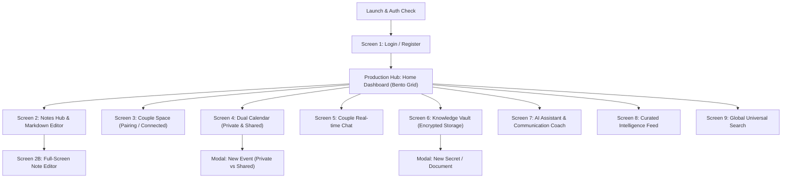

# 📱 Nexora Mobile — UI/UX Product Design Specification & Handover Document

**Document Version:** 2.0 (Production-Ready Architecture)  
**Project Location:** `A:\Projects\Nexora\mobile\nexora_mobile`  
**Target Platforms:** iOS & Android (Mobile First, Material 3 + iOS Human Interface Guidelines)  
**Target Audience:** Individuals and couples seeking a private, secure, all-in-one personal operating system with AI intelligence, shared planning, encrypted knowledge storage, and news curation.  
**Deliverables Required From Designer:** Figma Component Library, Auto-layout Design Kits, Dark & Light Mode Prototypes, Interactive User Journeys.

---

## 1. Product Vision & Design Identity

### 1.1 Core Value Proposition
**Nexora** is an intelligent personal operating system and private couple space. It eliminates app fragmentation by integrating:
1. **Personal Productivity:** Dynamic note-taking with pinning, tags, and multi-line editor.
2. **Private Couple Space:** Dual-user pairing via cryptographic 8-character invite codes, shared notes, and memory milestones.
3. **Dual-Layer Calendar:** Private individual events alongside synced couple events.
4. **Private Couple Chat:** Direct, encrypted communication channel between partners.
5. **Knowledge Vault:** Biometric-ready encrypted storage for PINs, credentials, identity cards, and sensitive documents.
6. **AI Assistant & Relationship Coach:** Context-aware LLM assistance plus relationship and communication coaching.
7. **Curated Intelligence Feed:** Tagged news covering AI, Tech, Science, Business, and Lifestyle with Top Stories filtering.
8. **Universal Search Index:** Single search query retrieving relevant notes, events, vault items, and news simultaneously.

### 1.2 Visual Tone & Aesthetic
* **Look & Feel:** High-end, futuristic yet warm. A blend of **Notion** (clean layout and typography) + **Arc Browser** (playful modern gradients) + **Between / Paired** (intimate, warm couple aesthetics).
* **Keywords:** Sleek, Private, Intelligent, Fluid, Reassuring.

---

## 2. Global Design System Foundations

### 2.1 Color Palette & Semantic Tokens

| Token Name | Light Mode Value | Dark Mode Value | Semantic Role |
| :--- | :--- | :--- | :--- |
| `Brand Primary (Deep Purple)` | `#6C5CE7` | `#8274ED` | App brand identity, AI actions, primary CTA |
| `Couple Accent (Warm Pink)` | `#FD79A8` | `#FF8FB8` | Couple Space, shared events, anniversary badges |
| `Vault Accent (Amber Gold)` | `#E17055` | `#F39C12` | Security badge, credentials, locked records |
| `Intelligence (Electric Blue)`| `#0984E3` | `#48DBFB` | News, external links, global search highlights |
| `Success (Emerald Green)` | `#00B894` | `#55EFC4` | Completed tasks, connected partner status |
| `Surface Canvas` | `#F8F9FE` | `#0D0E15` | App screen background |
| `Card / Container Surface` | `#FFFFFF` | `#161822` | Elevated modules, bento boxes, modals |
| `Stroke / Divider` | `#ECEFF8` | `#222538` | Card borders, table dividers |
| `Text Primary` | `#1E202B` | `#F5F6FA` | Primary headlines, bold figures |
| `Text Secondary` | `#718096` | `#A0AEC0` | Subtitles, timestamps, metadata |

### 2.2 Typography Hierarchy
* **App Headlines (Screen Titles):** *Plus Jakarta Sans* / *Inter*, Bold, `24px - 30px`.
* **Section Headers (Bento Card Titles):** Semi-Bold, `16px - 18px`.
* **Body Text (Notes, Chat, Vault payloads):** Regular / Medium, `14px - 15px`.
* **Monospace / Secure Data (Invite codes, PINs):** *JetBrains Mono*, Bold, `18px - 24px` with `3px` letter-spacing.
* **Badges & Chips:** Semi-Bold, `11px - 12px`, uppercase or title case.

### 2.3 Component Standards
* **Border Radius:**
  * Small (Buttons, Input fields, Chips): `12px`.
  * Medium (List items, Chat bubbles): `16px`.
  * Large (Bento cards, Bottom sheets): `24px`.
* **Touch Targets:** Minimum `48dp × 48dp` for all buttons and interactive icons.
* **Feedback Modals:** Bottom sheets with grab handles for quick creation; centered blur-backed dialogs for security authorizations.

---

## 3. Production Information Architecture (IA)

---

## 4. Screen-by-Screen Detailed UI/UX Specifications

---

### SCREEN 1: Authentication & Onboarding
**Files:** `lib/screens/login_screen.dart`, `lib/screens/register_screen.dart`

#### 1. Purpose
Secure identity gateway. Authenticates the user and initiates secure token storage (`token_storage.dart`).

#### 2. Layout & Elements
* **Brand Hero Banner:**
  * Radiant Nexora logo (Deep Purple with subtle pink glow).
  * Headline: *"Welcome to Nexora"*.
  * Tagline: *"Your private intelligence operating system"*.
* **Form Inputs:**
  * **Full Name** (Register screen only): Text field with person icon.
  * **Email:** Email input field with validation.
  * **Password:** Password field with trailing Show/Hide eye icon.
* **Interactive Controls:**
  * **Primary CTA:** Full-width pill button: `"Sign In"` / `"Create Account"`.
  * **State Toggle Button:** `"Don't have an account? Sign Up"` / `"Already registered? Sign In"`.
* **States & Edge Cases:**
  * *Loading:* Primary button transitions to centered circular spinner.
  * *Error Feedback:* Floating SnackBar with server message (e.g., *"Invalid email or password"*).

---

### SCREEN 2: Home Dashboard (The Executive Bento Hub)
**File:** `lib/main.dart` (`HomeScreen`)

#### 1. Purpose
The launchpad of the application. Upgrades standard raw vertical buttons to a modern **FinTech/Productivity Bento Grid** that provides glanceable widgets for all 8 modules.

#### 2. Top App Bar
* **Left:** User Greeting (`"Good morning, {FullName}"`) + Avatar with online status indicator.
* **Right Actions:**
  * **Search Icon:** Opens Global Search directly.
  * **Profile / Logout Icon:** Triggers session logout with confirmation prompt.

#### 3. Bento Grid Modules (Interactive Cards)
1. **Couple Space Hero Widget (Top Prominence - Pink Gradient Card):**
   * *If Unpaired:* Heart icon + *"Connect with your partner"* + *"Generate Code"* CTA.
   * *If Paired:* Partner's photo/name + *"Connected since Oct 2026"* + Unread chat pill.
2. **Notes Widget (Twin Column Left - Purple Border):**
   * Icon: Note pad + Count badge (`X Notes`).
   * Quick preview of the most recently pinned note title.
   * `+ Quick Note` shortcut tap target.
3. **Shared Calendar Widget (Twin Column Right - Teal Border):**
   * Next upcoming event title + Time pill + Shared/Private badge.
4. **AI Assistant & Coach Card (Wide Horizontal Card):**
   * Sparkle AI icon + *"Ask Nexora AI anything or get communication advice"*.
   * Input chip preview: *"Try: Help me draft a message..."*.
5. **Knowledge Vault Pill Card (Amber Accent):**
   * Shield lock icon + *"Knowledge Vault"* + Total items count + Subtitle: *"Encrypted & Protected"*.
6. **Curated News Mini-Feed:**
   * Headline ticker showing latest top story from AI/Tech feed.

---

### SCREEN 3: Personal Notes & Markdown Editor
**Files:** `lib/screens/notes_screen.dart`, `lib/screens/note_editor_screen.dart`

#### 1. Purpose
Organized personal knowledge capture supporting pinned notes, multi-line content, and quick editing.

#### 2. Screen 3A: Notes List (`notes_screen.dart`)
* **Header:** Title `"My Notes"` + Search icon + Refresh button.
* **Floating Action Button:** Circular `+` button in deep purple.
* **List / Grid Structure:**
  * Card elements:
    * **Pin Badge:** Push-pin icon in top-right (purple if pinned, transparent if unpinned).
    * **Title:** Bold (`16px`).
    * **Snippet:** 2-line preview with ellipsis.
    * **Timestamp:** Formatted local time.
  * **Actions:**
    * **Tap:** Opens full-screen Note Editor.
    * **Pin Toggle:** Pin/Unpin icon button.
    * **Delete Action:** Trash icon with confirmation dialog.
* **Edge States:**
  * *Empty State:* Friendly illustration + *"No notes yet. Tap + to capture your thoughts."*
  * *Error State:* Error text + `"Retry"` button.

#### 3. Screen 3B: Note Editor Screen (`note_editor_screen.dart`)
* **Top Navigation:**
  * Back icon (auto-prompts save on exit if modified).
  * Right: Pin/Unpin toggle icon.
  * Right: `"Save"` text button or checkmark icon.
* **Form Inputs:**
  * Title field: Borderless, large bold font (`22px`), placeholder `"Note Title"`.
  * Content field: Borderless, multi-line expanding canvas, placeholder `"Start typing..."`.

---

### SCREEN 4: Couple Space (Partner Pairing & Relationship Hub)
**File:** `lib/screens/couple_screen.dart`

#### 1. Purpose
A private shared environment between two users. Supports cryptographic invite pairing, shared status, and milestone tracking.

#### 2. State A: Unpaired / Pairing Flow
1. **Illustration & Explainer:**
   * Linked rings / double heart illustration.
   * Title: *"Connect with Your Partner"*.
   * Subtitle: *"Pair with exactly one partner to unlock Couple Mode, shared calendar, shared notes, and memory vault."*
2. **Step 1 Card: "Invite Your Partner":**
   * Button: `"Generate Invitation Code"` (with loading spinner).
   * **Generated Code Container:**
     * Prominent high-contrast container with `24px` bold monospace letters (e.g., `AB12CD34`).
     * Single-tap **"Copy to Clipboard"** icon.
     * Footnote: *"Valid for 48 hours. Single use only."*
3. **Step 2 Card: "Enter Partner's Code":**
   * Uppercase text field with hint `"e.g. XY98ZW12"`.
   * Primary Button: `"Connect Couple"` (Warm Pink background, `#FD79A8`).

#### 3. State B: Connected Couple View
* **Celebration Banner:**
  * Heart avatar combining user & partner profile initials.
  * Title: *"Connected Couple"*.
  * Partner Name: `"{Partner Full Name}"`.
  * Milestone: `"Connected since: {Date}"` + Days together counter badge.
  * Active Status Chip: `"Couple Mode Active"` (Pink gradient with heart).
* **Shared Actions Grid:**
  * Shortcut buttons to: `"Couple Chat"`, `"Shared Calendar"`, `"Shared Vault Items"`.

---

### SCREEN 5: Dual Calendar (Private & Shared Schedules)
**File:** `lib/screens/calendar_screen.dart`

#### 1. Purpose
Unified time management allowing users to track private obligations alongside shared couple events without leaking private schedule details.

#### 2. Layout & Elements
* **AppBar:** Title `"Calendar"` + Month/Week view switcher + Refresh icon.
* **Floating Action Button:** `+` Event icon.
* **Event Card Elements:**
  * **Time Block:** Start time to End time (`09:00 AM - 10:30 AM`).
  * **Event Title:** Bold headline.
  * **Location Badge:** Map pin icon + location name (if provided).
  * **Visibility Indicator:**
    * *Private Event:* Grey lock icon + `"Private (Only You)"`.
    * *Shared Event:* Pink heart icon + `"Shared with Partner"`.
  * **Delete Button:** Trash icon with quick delete confirmation.
* **"Add Event" Modal Bottom Sheet:**
  * Title input (`"Event Title"`).
  * Location input (`"Location (optional)"`).
  * Description input (`"Notes / Agenda"`).
  * Date & Time pickers (Start & End).
  * **Visibility Dropdown / Segmented Switch:**
    * Option 1: `🔒 Private (Only You)`
    * Option 2: `💖 Shared (With Partner)`
  * CTA: `"Save Event"`.

---

### SCREEN 6: Real-time Couple Chat
**File:** `lib/screens/chat_screen.dart`

#### 1. Purpose
An intimate, clutter-free messaging experience exclusively for the paired couple.

#### 2. Top App Bar
* Partner’s Name + Avatar.
* Status indicator (e.g., `"Connected"` with green dot).
* Refresh button.

#### 3. Message Stream (Bubble Layout)
* **Outgoing Messages (Current User):**
  * Aligned Right.
  * Bubble Color: Deep Purple / Brand gradient (`#6C5CE7`).
  * Text: White (`15px`).
  * Timestamp: Small muted white at bottom right of bubble.
* **Incoming Messages (Partner):**
  * Aligned Left.
  * Bubble Color: Warm Soft Pink / Neutral Dark Surface.
  * Text: Primary text color.
  * Timestamp: Muted timestamp.
* **Empty State:** Illustrated conversation bubble + *"Say something sweet to your partner..."*.

#### 4. Bottom Input Bar (Sticky)
* Text input field: Rounded pill (`24px` radius), multi-line expandable, hint `"Message partner..."`.
* Trailing Send Button: Circular button with arrow icon; animates when text is present.

---

### SCREEN 7: Knowledge Vault (Secure Encrypted Storage)
**File:** `lib/screens/vault_screen.dart`

#### 1. Purpose
A secure repository for storing sensitive information: credentials, passwords, card PINs, identity files, and confidential notes.

#### 2. Layout & Elements
* **AppBar:** Title `"Knowledge Vault"` + Shield icon + Refresh.
* **Search Bar:**
  * Top sticky search input: `"Search vault titles or tags..."`.
* **Category / Type Badges (Filter Tabs):**
  * `All` | `Documents` | `Secrets / Passwords` | `Cards / IDs`.
* **Vault Item Cards:**
  * Leading icon depending on type:
    * Document: File text icon.
    * Secret/Password: Key/Lock icon.
    * Card: Credit card icon.
  * Title & Description.
  * **Secret Payload Display:**
    * Displayed as obscured dots (`••••••••••••`).
    * **Eye Toggle Icon Button:** Tapping toggles between obscured and visible plain text.
    * **Quick Copy Icon Button:** Copies secret to clipboard with auto-clear warning.
  * **Visibility Tag:** `[Private]` vs `[Shared with Partner]`.
  * **Tags Chips:** Horizontal scroll of tags (e.g., `#finance`, `#home`, `#passwords`).
* **"Store in Vault" Dialog / Bottom Sheet:**
  * Title field.
  * Description field (optional).
  * Item Type Dropdown:
    * `0 = Document / Note`
    * `1 = Secret / Password / PIN` (enables secret masking)
    * `2 = Card / Identification`
  * Secret Payload text area.
  * Tags input field (comma separated).
  * Visibility selector (`Private` vs `Shared with Partner`).
  * Action CTA: `"Save to Vault"`.

---

### SCREEN 8: AI Assistant & Communication Coach
**File:** `lib/screens/ai_screen.dart`

#### 1. Purpose
A dual-purpose intelligence center featuring a contextual AI chat assistant and an automated relationship communication coach.

#### 2. Top Navigation Tabs
1. **Tab 1: "Ask AI" (General Intelligence)**
2. **Tab 2: "Relationship Coach" (Communication Advice)**

#### 3. Tab 1: "Ask AI" Interface
* **Context Input (Optional Accordion Card):**
  * Expandable card with label: *"Inject Context (e.g. Schedule, Notes, Background)"*.
* **Prompt Input Area:**
  * Multi-line text field with placeholder *"Ask anything (e.g. plan our weekend trip, summarize my day)..."*.
  * Action CTA: `"Ask AI"` (Deep Purple button with sparkle icon).
* **AI Output Card:**
  * Markdown-rendered response box.
  * Copy response icon button.
  * Model attribution tag (e.g., `"Powered by Nexora Intelligence"`).

#### 4. Tab 2: "Relationship Coach" Interface
* **Situation Description Card:**
  * Label: *"What is the situation or conflict?"* (e.g., *"We disagreed about holiday planning"*).
* **Draft Message Input Card:**
  * Label: *"What message do you plan to send?"*.
* **Action CTA:**
  * Button: `"Get Coach Feedback"` (Warm Pink button).
* **Coach Analysis Card (Output):**
  * **Tone Assessment Badge:** (e.g., `Empathetic`, `Defensive`, `Constructive`).
  * **Actionable Advice:** Bullet points offering tips to improve clarity and compassion.
  * **Suggested Rewrite Option:** One-tap copyable alternative phrasing.

---

### SCREEN 9: Curated Intelligence & News Feed
**File:** `lib/screens/news_screen.dart`

#### 1. Purpose
Clean, distraction-free news aggregator delivering updates across science, tech, AI, and lifestyle without ad bloat.

#### 2. Top App Bar & Filters
* **AppBar:** Title `"Curated News Feed"`.
* **Right Actions:**
  * **Star Toggle Icon:** Filters feed to show **"Top Stories Only"** (star turns gold when active).
  * **Refresh Icon:** Pulls latest syndicated articles.
* **Horizontal Category Carousel (Choice Chips):**
  * `All` | `Tech` | `AI` | `Business` | `Science` | `World` | `Health` | `Lifestyle`.

#### 3. Article Cards Feed
* **Image / Banner (if available):** Rounded `12px` top banner.
* **Category Pill:** Small upper badge (e.g., `TECH`, `AI`).
* **Title:** Bold headline (`16px - 18px`).
* **Summary Snippet:** 2-3 line brief.
* **Metadata Row:**
  * Source name (e.g., *"TechCrunch"*, *"Nature"*).
  * Publication time (e.g., *"2 hours ago"*).
  * External link button to read full article.

---

### SCREEN 10: Global Universal Search & Intelligence
**File:** `lib/screens/search_screen.dart`

#### 1. Purpose
Omni-channel search bar that queries across all personal and shared records in a single request.

#### 2. Search Input Header
* Prominent search text field with clear `(X)` icon and magnifying glass.
* Placeholder: *"Search notes, events, vault, news, and reminders..."*.

#### 3. Unified Results Stream
* **Result Card Component:**
  * **Color-Coded Type Badge:**
    * `Note`: Blue icon + badge.
    * `Calendar Event`: Green calendar icon + badge.
    * `Vault Secret`: Purple shield icon + badge.
    * `News`: Teal newspaper icon + badge.
    * `Reminder`: Orange clock icon + badge.
  * **Result Title & Match Snippet:** Highlighted query matches.
  * **Relevancy Score / Timestamp.**
  * **Tap Interaction:** Direct deep-link to the target screen (e.g., tapping a note opens the Note Editor).
* **Empty State:**
  * Pre-search: Quick suggestion chips (e.g., *"Recent Searches"*, *"Passwords"*, *"Anniversary"*).
  * No results found: Magnifying glass illustration + *"No matching records found for '{query}'"*.

---

## 5. UI/UX Micro-Interactions & State Matrix

| User Action | Visual Feedback | Micro-interaction Details |
| :--- | :--- | :--- |
| **Copy Invite Code** | Monospace text flashes purple | Haptic tick; SnackBar: *"Invite code copied to clipboard"* |
| **Reveal Vault Secret** | Eye icon toggles open; dots dissolve to plain text | 180ms fade-in transition |
| **Partner Connects** | Heart icon scales up with pulse animation | Full-screen subtle confetti / celebration micro-modal |
| **Send Message** | Bubble pops into bottom of chat list | Instant optimistic UI insert; scroll auto-snaps to bottom |
| **Toggle Top Stories** | Star icon turns solid Amber (`#F39C12`) | Feed smoothly cross-fades to filtered list |
| **Pin Note** | Pin icon turns deep purple; card moves to top | List item re-orders with smooth layout animation |

---

## 6. Designer Checklist & Deliverables Expected

When handing this specification to your UI/UX designer, request the following Figma deliverables:

* [ ] **Figma Design System / Style Guide:**
  * Color Styles (Deep Purple, Couple Pink, Vault Amber, Canvas tokens for Light and Dark modes).
  * Typography Hierarchy (Headers, Body, Monospace codes).
  * Form Elements (Inputs, Eye toggles, Dropdowns, Choice chips).
  * Interactive Component Sets (Buttons, Cards, Chat bubbles, Bottom navigation).
* [ ] **Flow 1 — Authentication:** Login, Registration, Validation states.
* [ ] **Flow 2 — Main Bento Dashboard:** Production Hub with all 8 module cards and user header.
* [ ] **Flow 3 — Couple Experience:** Unpaired Invitation Generator, Code Input, Connected Milestone View, Couple Chat stream.
* [ ] **Flow 4 — Productivity & Schedules:** Notes List, Full-screen Note Editor, Dual-Calendar (Private vs Shared filters).
* [ ] **Flow 5 — Security & Vault:** Knowledge Vault list, Reveal/Hide password states, New item modal.
* [ ] **Flow 6 — AI & Intelligence:** "Ask AI" tab, "Relationship Coach" input/output cards, News feed category chips, Universal Search results.
* [ ] **Interactive Prototype:** Clickable prototype demonstrating navigation from the Home Dashboard into Couple Space, Note Editor, and Knowledge Vault.
